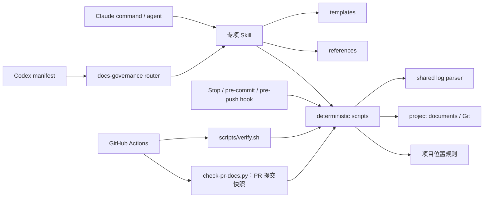
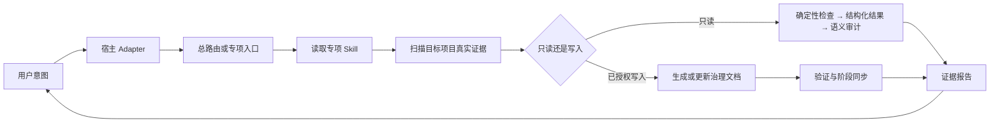

# ARCHITECTURE.md — docs-governance 当前架构

> 本文是插件**当前架构**的唯一说明入口。设计选择及其理由在 `docs/adr/README.md`；文件定位与误导清单在 `CLAUDE_MAP.md`；方法论唯一源仍在 `skills/<category>/<name>/SKILL.md`。

文档影响检索由 `scripts/find-doc-impact.py` 读取 Git 变更及 Markdown，输出带来源的候选；`change-impact` 判读事实，`docs-maintenance` 完成同步。脚本不执行目标项目代码、不替代语义判断；完整任务顺序见 [模块变更流程](skills/documentation/docs-governance/SKILL.md#模块变更流程)。

## 架构摘要

插件以 `skills/` 为窄腰：Claude Code、Codex 与 ChatGPT 各自通过宿主 Adapter 进入同一套方法论，命令和 agent 不复制方法论。规则、决策与历史保存在项目文档；接口字段以机器契约为准，执行结论以对应版本的运行证据为准。Markdown 登记这些证据的入口与解释，派生索引不替代原文。

## Module 权责与状态归属

| Module | 唯一职责 | 状态归属 | 对外 Interface | 允许依赖 | 禁止依赖 |
|---|---|---|---|---|---|
| 宿主 Adapter | 把 Claude Code、Codex、ChatGPT 的入口转换为统一 Skill 调用 | 无持久状态 | manifest、command、agent 调用约定 | 总路由与专项 Skill | 持有或复制方法论 |
| 总路由 | 根据用户意图选择专项 Skill 和执行顺序 | 无持久状态 | `skills/documentation/docs-governance/SKILL.md` | 专项 Skill | 复制专项方法论 |
| 专项 Skill | 保存治理方法论唯一真相 | 无运行时状态 | 各 `skills/<category>/<name>/SKILL.md` | 模板、参考与确定性脚本 | 宿主专用实现 |
| 模板与参考 | 提供空白载体和同步矩阵 | 无运行时状态 | `templates/`、`references/` | 无 | 反向依赖 agent 或 command |
| 日志格式 | 统一事件识别、原文边界及格式错误 | 无持久状态 | `scripts/logformat.py` 的 `parse_entries` / `Entry` / `LogFormatError` | Python 标准库 | 文件读写、CLI 退出、审计或归档策略 |
| 确定性执行 | 检查事实、生成结构化结果，并按需渲染文字或 JSON | 结果在本次内存中；`.governance/` 只保存可重建派生状态 | `scripts/`、`hooks/`、`.github/workflows/verify.yml` | 日志格式、项目文档、Git | 把派生索引或旧运行结果当当前事实 |

## 代码依赖图

> 箭头表示左侧实现依赖右侧 Interface。方法论依赖只能从宿主入口指向 Skill，不能把方法论复制回 command 或 agent。

## 运行时核心流转图

> 这张图表示运行时工作流，不代表代码依赖。审计默认只读；写入必须来自用户授权。

## Interface 与 Adapter 证据

| Interface / Seam | 定义位置 | Adapter / 调用方 | 约束唯一来源 |
|---|---|---|---|
| 插件发现 | `.claude-plugin/plugin.json`、`.codex-plugin/plugin.json` | Claude Code、Codex / ChatGPT | 双端 manifest |
| 方法论执行 | `skills/<category>/<name>/SKILL.md` | commands、agents、当前 Codex agent | 对应 Skill |
| Agent 入口内容规范 | `skills/documentation/agent-entrypoints/SKILL.md` | 总路由、统一 setup、活文档治理、当前 Agent | 主文件选择、事实输入、可执行规则和入口检查只在该 Skill；产品基线和文档读序继续引用既有 Skill |
| 架构文档判断与维护 | `skills/documentation/architecture-docs/SKILL.md` | 总路由、活文档治理、当前 Agent | 必要性判断、证据驱动的生成与审查；复用现有主记录，区分现状与计划 |
| 面向 AI 的文档写作 | `skills/documentation/writing-for-agents/SKILL.md` | 总路由、活文档治理、当前 Agent | 步骤与参考分层、按需读取、完成标准；本地补充核对含义 |
| Agent 入口长度检查 | `scripts/check-entrypoint-length.py` | `agent-entrypoints` 调用，只读检查显式文件列表 | 0 通过、1 超过 200 行、2 参数／读取错误；不安装 hook |
| 统一 setup 编排 | `living-docs-governance` 的“统一 setup”模式 | Claude Code 的 setup／init command 与 docs-governor；Codex / ChatGPT 当前 Agent | 确定项目范围 → docs-structure 规划 → 按需专项返回主记录 → 导航与状态 → agent-entrypoints → 按约定范围验证；子调用不重启 setup |
| 产品资料管理角色 | `agents/product-docs-manager.md` | Claude Code Agent；Codex / ChatGPT 当前 Agent 直接走共享 Skill | `product-evolution` 的管理员执行顺序、来源／编号／状态／授权边界；按需引用 change-impact 和 living-docs-governance |
| 项目文档生成 | `templates/*.example.md` | docs-governor 或当前 agent | 模板 + 对应 Skill |
| 机器契约模板 | `templates/openapi.example.json` | CONTRACT 模板、消费方/提供方校验器 | 单一 OpenAPI 文档 |
| 日志解析 | `scripts/logformat.py` | 文档审计、日志归档与索引 | 同一解析器，调用方决定失败处理 |
| 文件位置与触发规则 | `.docs-governance.json`、`scripts/docpolicy.py` | Stop、暂存区检查、full/artifacts 审计 | [规则接口](references/document-policy.md) |
| Stop 治理根定位 | `scripts/auto-audit.py` 的 `governance_root` | Stop 包装与直接 CLI 共用 | 显式根优先、Git 边界内最近配置、旧四件套回退；无法定位报告未执行，细则见规则接口 |
| PR 前文档扫描 | `scripts/check-pr-docs.py`、`scripts/install-pre-push.py`、`hooks/pre-push.sh` | Agent 创建 PR 前、本地推送与 PR CI | 实际目标分支的共同祖先、来源提交快照、变更到文档的映射；临时 index 与 HEAD 不修改原仓库；安装快照与原 hook 备份归 Git 公共元数据，不随分支切换 |
| 确定性审计 | `scripts/audit-cheap.sh`、`scripts/audit-docs.py` | governance-audit、CI、当前 Agent | 退出码及结构化结果，见 `references/audit-result-format.md` |
| 测试与发布前验证 | `TESTS.md`、`scripts/verify.sh` | 本地开发、GitHub Actions | TEST-ID + 命令退出码 |

项目已有代码审查与测试工具继续执行各自职责。治理 Skill 引用其版本、范围、结论和证据位置；当前没有新增外部工具调度器或结果导入服务。运行结果是一次观测，相关实现变化后需要复验，不能仅凭旧报告更新当前健康为绿。

`pr-review` 在专项 Skill 层编排当前 PR／分支审核：固定 base/head 与集成对象，按已确认需求和规范检查完整路径，复用影响、契约、测试、下游回归及文档事实核对。隔离执行回退／破坏检查，输出与版本对应的报告；不持有 PR 状态，不默认向平台写入或合并，也不新增扫描器／调度器。历史经验生命周期仍归 project-retro。

`project-retro` 在专项 Skill 层统一从指定对话、LOG、commit、审查与运行证据回顾 Agent 工作，环境、文档、实现、测试、协作与发布是检查面；经验生命周期在包内 lessons.md 维护，目标项目的经验正文沿用其唯一主记录。总路由、governance-retro、活文档与协作治理均指向同一方法；旧独立复盘 Skill 从活动目录移除。测试资产登记、下游回归和资料维护继续复用原有专项 Skill，不新增执行服务或自动触发器。

现有展示版架构图在 `diagram/architecture.svg`，渲染预览为 `diagram/architecture.png`；若它与本文冲突，以本文和真实代码为准，并在同次结构变更中同步展示图。

产品文档由 `skills/documentation/product-evolution/SKILL.md` 在现有专项 Skill 层承接，使用 `templates/product-index.example.md` 组织十阶段产物。本插件实际入口为 [产品管理](docs/product/README.md)；需求与确认由产品文档承载，任务状态仍归 Issue Tracker，业务验收不由确定性脚本代判。Stop 用内容指纹避免重复审计，提交护栏检查真实暂存快照；现有推送／PR CI 复用同一规则，不新增每日定时器。

项目健康证据由 `scripts/collect-project-health.py` 只读采集项目内入口、验证命令、CI 与显式 JSON 记录，输出带文件指纹的候选，不执行被发现的脚本、不判整体健康。现有 `living-docs-governance` 负责解释和路由，文档审计仍复用 `scripts/audit-docs.py`；没有全局配置或会话历史依赖。

`agent-workflow-governance` 在专项 Skill 层承接治理规则落点与散落工作流检查，按需读取附件并复用现有主记录、专项 Skill 和采集能力；只输出证据与建议，不新增执行服务、Hook 或门禁。

## 更新规则

模块建档由 [module-governance](skills/documentation/module-governance/SKILL.md) 按任务意图编排：入口规范交给 agent-entrypoints，领域语言与决策交给 domain-modeling，接口核对交给 contract-first，文档／代码边界交给 architecture-docs；maintenance 同步引用，audit 只读核对覆盖。已有根入口或共享主记录充分覆盖时直接复用，局部入口只补真实新增约定。生成后复用 artifacts 链接审计，不增加执行服务。

领域建模复用 [Matt 的 domain-modeling](skills/documentation/domain-modeling/SKILL.md) 固定版本，方法与格式随包提供，不依赖用户额外安装。授权、既有主记录、模块简短决策内联及审计衔接仅在其 [project-adapter](skills/documentation/domain-modeling/project-adapter.md) 维护；`context-and-decisions` 是无重复正文的兼容入口。术语仍归对应 CONTEXT，接口定义与决策理由不复制进词汇表。

- 宿主入口、路由、专项 Skill、模板/参考或确定性脚本的职责及依赖变化 → 同次更新本文。
- 难回退的架构选择及理由 → 按 domain-modeling 选择既有 ADR 或简短模块内联记录；本文只反映 accepted 决策后的当前结构。
- Interface 字段、测试证据和下游命令分别留在 CONTRACT、TESTS、REGRESSION 对应载体，不复制进本文。
